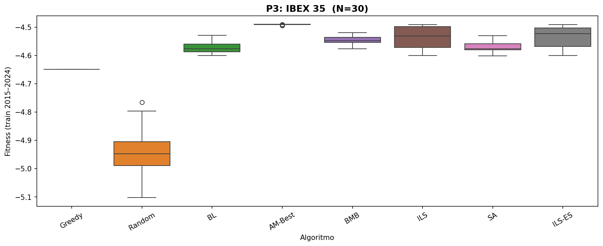
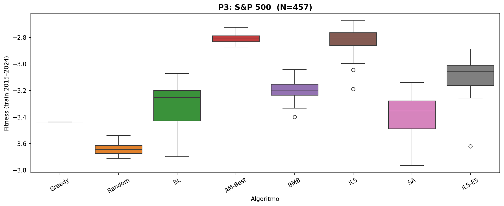
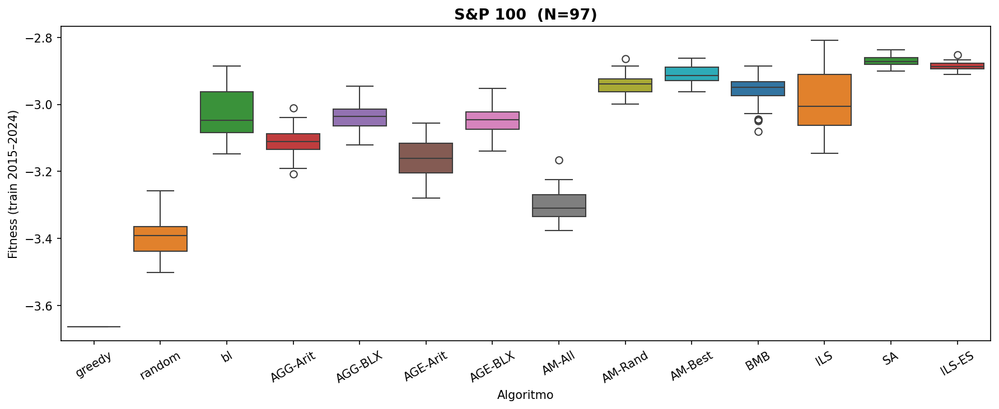
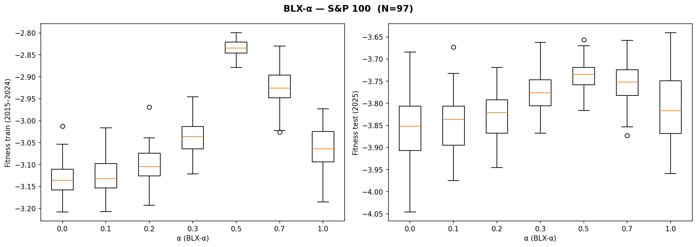

# Selección de Carteras con Metaheurísticas

[](https://github.com/0xjoseangel/portfolio/actions/workflows/cmake-multi-platform.yml)


**Asignatura:** Metaheurísticas — Grado en Ingeniería Informática y ADE, UGR (curso 2025-26)
**Autor:** Jose Angel Carretero Montes — Grupo 3

Implementación y comparación experimental de **14 metaheurísticas** —
constructivas, de trayectoria y poblacionales — aplicadas al problema de
**selección de carteras**, desarrolladas a lo largo de las tres prácticas de
la asignatura (P1 → P2 → P3).

---

## El problema

Dado un conjunto de `N` activos financieros, se busca un vector de pesos
`w = (w_1, ..., w_N)` (cada `w_i = 0` o `w_i ∈ [lo, hi]`, con `Σ w_i = 1`) que
maximice

```
fitness(w) = Beneficio(w) − λ · Riesgo(w)        (λ = 500)
```

donde:

- `Beneficio(w) = Σ_i w_i · r_i`, con `r_i` el retorno logarítmico acumulado
  del activo `i` durante el periodo de entrenamiento.
- `Riesgo(w) = √(wᵀ · Cov · w)`, la volatilidad de la cartera, con `Cov` la
  matriz de covarianzas de los retornos diarios.

Cada solución se evalúa con datos de **2015-2024 (entrenamiento)** y se
valida con datos de **2025 (test)**, nunca vistos durante la optimización.

### Datasets (`data/`)

| Dataset | Activos (N) | `lo` / `hi` por activo |
|---|---|---|
| `ibex_35.csv` | 30  | 0.005 / 0.08 |
| `syp_100.csv` | 97  | 0.005 / 0.05 |
| `syp_500.csv` | 457 | 0.005 / 0.02 |

> Los CSV de datos no se incluyen en el repositorio por tamaño (hasta 27MB);
> ver [`.gitignore`](.gitignore). Los resultados ya generados están en
> [`results/`](results/).

---

## Evolución del proyecto (P1 → P2 → P3)

- **Práctica 1**: heurística constructiva (**Greedy**) y dos algoritmos de
  trayectoria de referencia (**Random Search**, **Búsqueda Local**).
- **Práctica 2**: algoritmos **genéticos** (esquemas generacional/estacionario
  × cruce aritmético/BLX-α) y **meméticos** (hibridación AG + Búsqueda Local).
- **Práctica 3**: metaheurísticas de trayectoria avanzadas — **BMB**, **ILS**,
  **Enfriamiento Simulado (SA)** e **ILS con SA embebido (ILS-ES)**.

### Catálogo de algoritmos

| Categoría | Algoritmo | Descripción | Código |
|---|---|---|---|
| Constructivo | **Greedy** | Construye la solución en una sola pasada ordenando los activos por una heurística beneficio/riesgo medio. | [`inc/greedy.h`](inc/greedy.h) · [`src/greedy.cpp`](src/greedy.cpp) |
| Trayectoria | **Random Search** | Genera 10 000 soluciones aleatorias válidas y devuelve la mejor. Cota inferior de referencia. | [`inc/randomSearch.h`](inc/randomSearch.h) · [`src/randomSearch.cpp`](src/randomSearch.cpp) |
| Trayectoria | **Búsqueda Local (BL)** | Primero-mejor sobre un vecindario de intercambios de pares de pesos (ratio 0.4), partiendo de una solución aleatoria. | [`inc/localsearch.h`](inc/localsearch.h) · [`src/localsearch.cpp`](src/localsearch.cpp) |
| Trayectoria | **BMB** (Multiarranque básico) | Repite BL desde soluciones iniciales aleatorias distintas (≤2000 evals. cada una) hasta agotar el presupuesto y conserva el mejor óptimo local. | [`inc/bmb.h`](inc/bmb.h) · [`src/bmb.cpp`](src/bmb.cpp) |
| Trayectoria | **ILS** (Búsqueda Local Iterada) | Aplica BL desde una solución aleatoria; en cada iteración perturba el 20% de los pesos de la mejor solución y repite BL, aceptando solo si mejora. | [`inc/ils.h`](inc/ils.h) · [`src/ils.cpp`](src/ils.cpp) |
| Trayectoria | **SA** (Enfriamiento Simulado) | El vecino se genera moviendo una fracción del peso entre dos activos al azar. Acepta peores soluciones según Metrópolis con esquema de enfriamiento de Cauchy. | [`inc/sa.h`](inc/sa.h) · [`src/sa.cpp`](src/sa.cpp) |
| Trayectoria | **ILS-ES** | Como ILS, pero usando SA como búsqueda local embebida; el presupuesto de evaluaciones se reparte entre los reinicios. | [`inc/ils_es.h`](inc/ils_es.h) · [`src/ils_es.cpp`](src/ils_es.cpp) |
| Poblacional | **AGG-Arit / AGG-BLX** | Algoritmo genético generacional (población=100, cruce con prob. 0.8, torneo binario, elitismo) con cruce aritmético o BLX-α (α=0.3). | [`inc/genetic.h`](inc/genetic.h) · [`src/genetic.cpp`](src/genetic.cpp) |
| Poblacional | **AGE-Arit / AGE-BLX** | Igual que AGG, pero con esquema estacionario (cruce siempre, reemplazo por duelo contra el peor de la población). | ídem |
| Poblacional | **AM-All / AM-Rand / AM-Best** | Memético: AGG-BLX + Búsqueda Local cada 10 generaciones sobre toda la población, sobre el 10% aleatorio o sobre los 10 mejores individuos, respectivamente. | ídem |

---

## Estructura del proyecto

```
portfolio/
├── main.cpp              # Comparativa completa: 14 algoritmos × 3 datasets × 50 semillas
├── main_p3.cpp            # Comparativa final P3 (Greedy/Random/BL + AM-Best + BMB/ILS/SA/ILS-ES)
├── main_blx_alpha.cpp      # Estudio del parámetro α de BLX-α
├── main_sa_params.cpp       # Estudio de los parámetros φ y k_vecinos de SA
├── boxplot.py                # Genera los boxplots (PNG) a partir de los CSV de resultados
├── CMakeLists.txt
├── common/                 # Interfaces e infraestructura genérica
│   ├── mh.h                 # MH<tDomain> / ResultMH<tDomain>
│   ├── problem.h              # Problem<tDomain>
│   ├── solution.h               # tSolution<T>, tFitness
│   ├── random.hpp                # Generador pseudoaleatorio
│   └── util.h                     # Utilidades varias
├── inc/ , src/              # Declaración (.h) e implementación (.cpp) de cada algoritmo
├── data/                      # Datasets CSV (no versionados)
├── docs/
│   ├── p1/memoria.pdf          # Memoria P1 — Greedy, Random Search, BL
│   ├── p2/memoria2.pdf          # Memoria P2 — Algoritmos genéticos y meméticos
│   └── p3/memoria3.pdf           # Memoria P3 — BMB, ILS, SA, ILS-ES
├── results/
│   ├── all_algorithms/           # Salida de ./main
│   ├── p3/                        # Salida de ./main_p3
│   └── studies/                    # Salida de ./study_blx_alpha y ./study_sa_params
└── LICENSE
```

---

## Compilación

```bash
rm -rf CMakeFiles CMakeCache.txt *.cmake && cmake . && make
```

> **Importante**: limpia siempre la caché de CMake antes de compilar. El
> proyecto usa `-O3 -march=native -ffast-math` y OpenMP (paralelización de
> `fitness()`, la operación O(N²) dominante); si CMake reutiliza una
> configuración previa estas optimizaciones no se aplican y la ejecución
> puede llegar a ser ~40x más lenta. Tras la primera compilación, los
> cambios de código se pueden recompilar simplemente con `make`.

La compilación genera 4 ejecutables: `main`, `main_p3`, `study_blx_alpha` y
`study_sa_params`.

---

## Ejecución

Todos los ejecutables aceptan los mismos argumentos opcionales:
`./<programa> [max_evals] [n_seeds]` (por defecto `10000` y `50`).

| Ejecutable | Qué hace | Salida |
|---|---|---|
| `./main` | Ejecuta los **14 algoritmos** sobre los 3 datasets con 50 semillas compartidas. | `results/all_algorithms/results_*.csv` |
| `./main_p3` | Comparativa final: Greedy, Random, BL, AM-Best (mejor algoritmo de P2), BMB, ILS, SA, ILS-ES. | `results/p3/p3_results_*.csv`, `results/p3/p3_stats_*.csv` |
| `./study_blx_alpha` | Estudia α ∈ {0, 0.1, 0.2, 0.3, 0.5, 0.7, 1.0} para AGG-BLX. | `results/studies/blx_alpha_*.csv` |
| `./study_sa_params` | Estudia φ ∈ {0.05, ..., 0.9} y k_vecinos ∈ {2, ..., 30} para SA. | `results/studies/sa_phi_*.csv`, `results/studies/sa_kvecinos_*.csv` |
| `python3 boxplot.py` | Genera los `.png` de cada CSV en `results/{all_algorithms,p3,studies}`. Requiere `pandas`, `seaborn`, `matplotlib`. | `results/**/*.png` |

---

## Resultados

### Práctica 3 — comparativa final (50 semillas, 10 000 evaluaciones)

Fitness medio (± desviación típica) sobre el periodo de entrenamiento
(2015-2024) y de test (2025), beneficio acumulado en test, número medio de
evaluaciones consumidas y tiempo medio de ejecución.

**IBEX 35 (N=30)**

| Algoritmo | Fit. Train (±σ) | Fit. Test 2025 (±σ) | Beneficio 2025 | Evaluaciones | Tiempo (s) |
|---|---|---|---|---|---|
| Greedy  | -4.6495 ± 0.0000 | -3.3868 ± 0.0000 | 0.1152 | 1     | 0.0000 |
| Random  | -4.9411 ± 0.0701 | -3.3060 ± 0.1039 | 0.0360 | 10000 | 0.0234 |
| BL      | -4.5727 ± 0.0191 | -3.1095 ± 0.0083 | 0.0218 | 1257  | 0.0011 |
| **AM-Best** | **-4.4905 ± 0.0007** | **-3.0841 ± 0.0034** | 0.0332 | 10000 | 0.0110 |
| BMB     | -4.5464 ± 0.0143 | -3.1022 ± 0.0081 | 0.0233 | 6041  | 0.0044 |
| ILS     | -4.5354 ± 0.0370 | -3.0960 ± 0.0135 | 0.0256 | 5070  | 0.0026 |
| SA      | -4.5713 ± 0.0173 | -3.1090 ± 0.0082 | 0.0226 | 1906  | 0.0005 |
| ILS-ES  | -4.5337 ± 0.0353 | -3.0954 ± 0.0150 | 0.0257 | 7377  | 0.0019 |

**S&P 100 (N=97)**

| Algoritmo | Fit. Train (±σ) | Fit. Test 2025 (±σ) | Beneficio 2025 | Evaluaciones | Tiempo (s) |
|---|---|---|---|---|---|
| Greedy  | -3.6635 ± 0.0000 | -5.0204 ± 0.0000 | 0.0099 | 1     | 0.0000 |
| Random  | -3.3904 ± 0.0554 | -4.1131 ± 0.1928 | 0.0799 | 10000 | 0.0543 |
| BL      | -3.0324 ± 0.0673 | -3.8698 ± 0.0325 | 0.0971 | 5259  | 0.0296 |
| **AM-Best** | **-2.9116 ± 0.0248** | **-3.7253 ± 0.0330** | 0.0939 | 10001 | 0.1061 |
| BMB     | -2.9575 ± 0.0414 | -3.8446 ± 0.0284 | 0.0938 | 10000 | 0.0846 |
| ILS     | -2.9827 ± 0.0975 | -3.8514 ± 0.0460 | 0.0959 | 10000 | 0.0530 |
| SA      | -3.0327 ± 0.0670 | -3.8733 ± 0.0309 | 0.0933 | 8433  | 0.0114 |
| ILS-ES  | -2.9981 ± 0.0964 | -3.8359 ± 0.0591 | 0.0927 | 8866  | 0.0118 |

**S&P 500 (N=457)**

| Algoritmo | Fit. Train (±σ) | Fit. Test 2025 (±σ) | Beneficio 2025 | Evaluaciones | Tiempo (s) |
|---|---|---|---|---|---|
| Greedy  | -3.4384 ± 0.0000 | -5.2046 ± 0.0000 | -0.0628 | 1     | 0.0002 |
| Random  | -3.6419 ± 0.0422 | -4.4297 ± 0.1666 | 0.0123  | 10000 | 1.3915 |
| BL      | -3.3176 ± 0.1643 | -4.2284 ± 0.1189 | 0.0079  | 9840  | 0.7828 |
| **AM-Best** | **-2.8113 ± 0.0314** | **-3.9072 ± 0.0650** | 0.0169  | 10000 | 1.6526 |
| BMB     | -3.1953 ± 0.0715 | -4.1265 ± 0.0619 | 0.0111  | 10000 | 1.7395 |
| ILS     | -2.8191 ± 0.0949 | -4.0035 ± 0.0543 | 0.0153  | 10000 | 1.2228 |
| SA      | -3.3935 ± 0.1539 | -4.2095 ± 0.1222 | 0.0179  | 9141  | 0.3106 |
| ILS-ES  | -3.0865 ± 0.1153 | -4.0054 ± 0.1124 | 0.0193  | 10000 | 0.3362 |

**Lectura rápida**: `AM-Best` (el mejor algoritmo de P2) obtiene el mejor
fitness de entrenamiento y de test en los tres datasets, pero agotando
siempre las 10 000 evaluaciones. `SA` alcanza una calidad muy similar a `BL`
con una fracción de las evaluaciones (1906 frente a 1257-9840 según el
dataset) y tiempos de ejecución muy bajos. `ILS` e `ILS-ES` son los que mejor
escalan en S&P 500, acercándose mucho a `AM-Best` con tiempos de ejecución
3-5 veces menores.

<p align="center">
  
  
</p>

### Prácticas 1 y 2

La comparativa con los 14 algoritmos (incluyendo AGG/AGE × Aritmético/BLX-α y
las tres variantes meméticas) está en
[`results/all_algorithms/`](results/all_algorithms/), y el estudio del
parámetro α de BLX-α en [`results/studies/`](results/studies/). Las tablas
completas con los tests estadísticos están en
[`docs/p2/memoria2.pdf`](docs/p2/memoria2.pdf).

<p align="center">
  
  
</p>

---

## Documentación completa

- [`docs/p1/memoria.pdf`](docs/p1/memoria.pdf) — Práctica 1 (Greedy, Random Search, BL)
- [`docs/p2/memoria2.pdf`](docs/p2/memoria2.pdf) — Práctica 2 (algoritmos genéticos y meméticos)
- [`docs/p3/memoria3.pdf`](docs/p3/memoria3.pdf) — Práctica 3 (BMB, ILS, SA, ILS-ES)

---

## Licencia

Distribuido bajo licencia [GPL-3.0](LICENSE).
